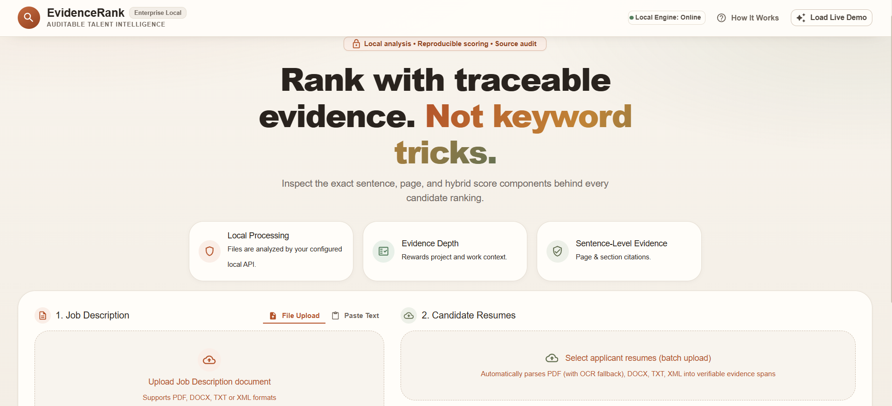
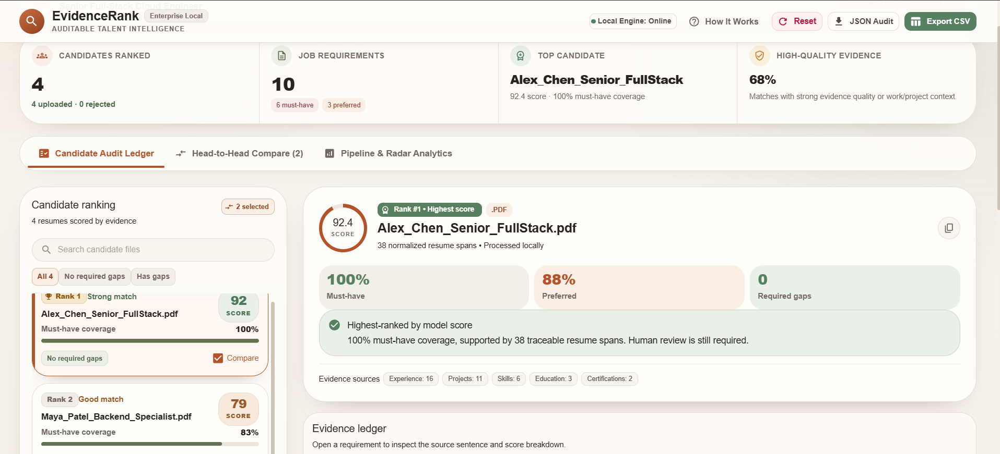
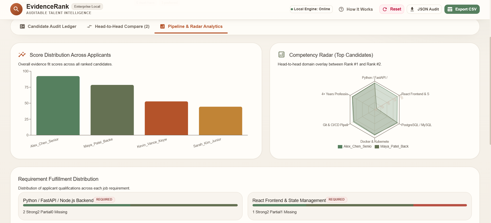
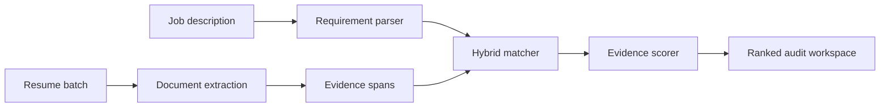

# EvidenceRank

**A local, evidence-first resume-ranking system that compares candidates against structured job requirements and exposes the source behind every score.**

EvidenceRank accepts one job description and a batch of resumes, extracts requirement-level evidence, combines lexical and semantic matching, and produces an auditable ranking. Every match can be traced to the original resume sentence, page, section, matched terms, and scoring components.

> EvidenceRank is decision-support software, not an autonomous hiring authority. Its scores measure evidence found in submitted resumes; they are not hiring probabilities.



## What it does

- Extracts PDF, DOCX, TXT, and XML resumes through one document pipeline
- Falls back to OCR when a PDF page contains no usable text
- Parses required, preferred, and contextual job requirements
- Groups valid alternatives such as MySQL / PostgreSQL / MongoDB
- Matches requirements using BM25, exact aliases, related terms, and sentence embeddings
- Rewards evidence in projects and experience over unsupported skill-list mentions
- Produces stable candidate scores that do not change when unrelated candidates are added
- Shows strong, partial, weak, and missing decisions for every requirement
- Compares up to three candidates side by side
- Visualizes score and requirement-fulfilment distributions
- Exports complete JSON audits and CSV ranking reports
- Runs through a React interface backed by a local FastAPI service

## Interface

### Candidate audit

The audit ledger shows the evidence fit score, must-have coverage, required gaps, source sections, and requirement-level scoring breakdown. The interface reports model output without making an automatic interview or rejection decision.



### Pipeline analytics

Analytics summarize score distribution, top-candidate competency coverage, and requirement fulfilment across the uploaded batch.



The screenshots use bundled synthetic demo profiles. Their values demonstrate the interface and are not evaluation results or calibrated hiring thresholds.

## How it works



### 1. Document extraction

- **PDF:** PyMuPDF first, pdfplumber fallback, and RapidOCR for unusable pages
- **DOCX:** paragraph- and table-aware extraction using python-docx
- **TXT:** encoding-aware extraction, including UTF-16
- **XML:** safe parsing with defusedxml

Each file becomes a shared `ExtractedDocument` structure with page-level quality information and warnings.

### 2. Evidence normalization

Resume text is divided into traceable spans from sections including skills, projects, experience, education, certifications, coursework, achievements, and leadership. Each span keeps its original text, page, section, word count, action-verb flag, and numeric-evidence flag.

### 3. Job requirement parsing

The parser recognizes headings such as `MUST-HAVE SKILLS`, `GOOD-TO-HAVE SKILLS`, and `SOFT SKILLS`. Requirements are assigned one of three priorities:

- **Required:** mandatory requirements with the greatest scoring weight
- **Preferred:** useful differentiators between otherwise similar candidates
- **Contextual:** responsibilities and general role relevance

When wording permits alternatives, the parser creates a single grouped requirement so evidence for any valid option can satisfy it.

### 4. Hybrid matching

Every requirement is compared with each usable evidence span using:

- Boundary-safe exact skill aliases
- Candidate-local BM25 lexical retrieval
- Semantic similarity from `sentence-transformers/all-MiniLM-L6-v2`
- Curated related terms
- Evidence quality based on section, action verbs, and quantified outcomes

The approximate requirement score is:

```text
match = evidence_quality * (
    0.45 * semantic_score
    + 0.35 * keyword_score
    + 0.20 * relation_score
)
```

An explicitly requested technical skill cannot receive a strong match from semantic similarity alone. Direct or related evidence must also be present.

### 5. Candidate scoring

```text
70% required coverage
15% preferred coverage
 5% contextual coverage
10% evidence depth
- missing-required penalty
```

The weights and thresholds are centralized in `src/config.py`. Evidence fit scores are intentionally conservative and should be interpreted alongside the requirement ledger.

## Evaluation

### Mixed-format processing

The extraction and normalization pipeline processed 220 supplied mixed-format documents without unresolved extraction failures:

| Format | Documents |
|---|---:|
| DOCX | 122 |
| PDF | 54 |
| XML | 22 |
| TXT | 22 |
| **Total** | **220** |

Across those documents, normalization produced 3,831 evidence spans. A separate image-only PDF was also recovered using OCR.

### Human-labelled ranking pilot

A blinded, role-specific pilot used 30 real resume documents labelled on a four-level relevance scale. Filenames were blinded during judgement, and the evaluation data remains outside the public repository.

| Metric | Result |
|---|---:|
| NDCG@5 | 1.0000 |
| NDCG@10 | 0.9579 |
| Precision@5 | 1.0000 |
| Precision@10 | 0.6000 |
| Recall@5 | 0.7143 |
| Recall@10 | 0.8571 |
| Pairwise accuracy | 0.9024 |

These results are encouraging but preliminary. The pilot is small and role-specific, so it does not establish general hiring validity or fairness across occupations and populations.

## Project structure

```text
EvidenceRank/
|-- .github/workflows/ci.yml  # Backend and frontend CI
|-- evaluation/               # Blinded pilot and metric utilities
|-- frontend/                 # React + Vite recruiter console
|-- src/
|   |-- api.py                # FastAPI routes and orchestration
|   |-- config.py             # Validated matching, scoring, and upload settings
|   |-- document_extractor.py # Multi-format dispatcher
|   |-- extractor.py          # PDF extraction and OCR fallback
|   |-- normalizer.py         # Section-aware evidence spans
|   |-- jd_parser.py          # Requirement parsing
|   |-- skill_catalog.py      # Canonical skills and aliases
|   |-- matcher.py            # Hybrid evidence matching
|   |-- scorer.py             # Candidate scoring and ranking
|   `-- schemas.py            # Shared Pydantic models
|-- tests/                    # Core, API, and evaluation tests
|-- data/incoming/.gitkeep
|-- pyproject.toml
|-- requirements.txt
`-- requirements-dev.txt
```

Private resumes, extracted text, normalized caches, and evaluation labels are excluded from version control.

## Local setup

### Prerequisites

- Python 3.11
- Node.js 22.12 or newer
- npm
- Conda is optional but convenient on Windows

### Backend

```bash
conda create -n evidencerank python=3.11 -y
conda activate evidencerank
python -m pip install -r requirements.txt
python -m uvicorn src.api:app --reload --port 8000
```

The API runs at `http://127.0.0.1:8000`. Interactive documentation is available at `http://127.0.0.1:8000/docs`.

The sentence-transformer model is downloaded on first use if it is not already cached, so the first analysis can take longer. Resume ranking itself does not require a cloud LLM or external scoring API.

### Frontend

Open another terminal:

```bash
cd frontend
npm install
npm run dev
```

Open `http://localhost:5173`.

The frontend uses `http://127.0.0.1:8000` by default. To target a different backend, define `VITE_API_URL` before starting or building the frontend.

## Tests and quality checks

Install development dependencies and run the Python suite:

```bash
python -m pip install -r requirements-dev.txt
python -m pytest
```

The current suite contains 30 tests covering core matching behavior, candidate-pool score stability, candidates without searchable evidence, API upload validation, safe error responses, end-to-end ranking, and evaluation metrics.

Verify the frontend:

```bash
cd frontend
npm run lint
npm run build
```

GitHub Actions runs the backend tests and frontend lint/build checks on pushes and pull requests.

## API

### Health check

```http
GET /health
```

### Rank candidates

```http
POST /rank
Content-Type: multipart/form-data
```

Form fields:

- `job_description`: one PDF, DOCX, TXT, or XML file
- `resumes`: one or more PDF, DOCX, TXT, or XML files

The response includes the parsed requirements, batch summary, ranked candidates, requirement-level evidence, component scores, warnings, and any rejected files.

## Privacy and responsible use

EvidenceRank is designed for local decision support:

- Uploaded files are sent to the configured EvidenceRank API, which defaults to localhost.
- Resume contents are not intentionally sent to a cloud LLM or external ranking service.
- The frontend does not load external web fonts.
- Protected characteristics are not explicit scoring inputs.
- A missing match means evidence was not found in the submitted resume; it does not prove that the candidate lacks the skill.
- Human reviewers retain responsibility for interpreting evidence and making decisions.

Do not use EvidenceRank as the sole basis for employment decisions without independent validation, bias testing, security review, accessibility review, and appropriate legal assessment.

## Current limitations

- The curated skill catalogue is useful but not exhaustive.
- Soft skills are difficult to establish from resume text alone.
- Only the strongest evidence span is retained for each requirement.
- Experience duration and overlapping dates are not deeply validated.
- Scores are not calibrated hiring probabilities and no universal shortlist threshold is defined.
- The labelled pilot is too small and role-specific to establish broad validity or fairness.
- OCR has not been benchmarked across every scan quality, rotation, language, or document layout.
- CPU inference is intended for relatively small local batches.
- Formal security, accessibility, and disparate-impact audits have not yet been completed.

## Roadmap

- Recruiter review and editing of parsed requirements before ranking
- Multiple-evidence aggregation for each requirement
- Experience-duration and employment-date reasoning
- Name and contact-detail masking for blinded review
- Job-description bias and exclusionary-language checks
- Evaluation across multiple job families and independent human raters
- Threshold calibration only after sufficient labelled evidence
- Saved local analysis sessions
- Docker-based startup and deployment documentation
- Formal accessibility and security review

## Origin

EvidenceRank began as an entry for the InternLoom AI Hackathon at Manipal Institute of Technology and continued as an explainable information-retrieval and responsible-AI portfolio project.

## License

No open-source license has been granted yet. The repository is publicly viewable, but reuse, modification, and redistribution require the author's permission unless a license is added later.
