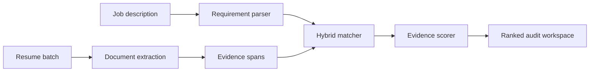

# EvidenceRank

**A local, explainable resume-ranking system that evaluates candidates against structured job requirements and shows the evidence behind every decision.**

EvidenceRank accepts one job description and a batch of resumes, extracts requirement-level evidence, combines semantic and keyword matching, and returns a ranked shortlist. Recruiters can inspect the exact sentence, page, section, matched terms, and component scores behind each result.

The matching pipeline runs locally. Resume contents are not sent to an LLM or an external scoring API.

## Why EvidenceRank?

Keyword filters miss candidates who describe relevant experience differently. Pure embedding similarity can also produce unsupported matches for explicitly requested tools. EvidenceRank combines both approaches and adds evidence-quality safeguards.

Key capabilities:

- Sentence embeddings, BM25, exact aliases, and related-term matching
- Required, preferred, and contextual job requirements
- Grouped `OR` alternatives such as MySQL / PostgreSQL / MongoDB
- Evidence-aware scoring that favors projects and experience over skill-list mentions
- Exact source evidence with page and resume-section provenance
- PDF, DOCX, TXT, and XML extraction
- OCR fallback for scanned PDFs
- React recruiter console with a local FastAPI backend
- Downloadable JSON audit report

## How it works



### Document extraction

- **PDF:** PyMuPDF first, pdfplumber fallback, and RapidOCR for unusable pages
- **DOCX:** paragraph and table-aware extraction using python-docx
- **TXT:** encoding-aware extraction, including UTF-16
- **XML:** safe parsing with defusedxml

Every format is converted to the same `ExtractedDocument` schema with page-level quality warnings.

### Evidence normalization

Resume text is divided into evidence spans from sections such as skills, projects, experience, education, certifications, coursework, achievements, and leadership. Each span retains its original text, page, section, word count, action-verb flag, and numerical-evidence flag.

### Job requirement parsing

The parser recognizes headings such as `MUST-HAVE SKILLS`, `GOOD-TO-HAVE SKILLS`, and `SOFT SKILLS`. Requirements are classified as:

- **Required:** mandatory and dominant in scoring
- **Preferred:** used to distinguish otherwise similar candidates
- **Contextual:** responsibilities and general role relevance

Alternative technologies are grouped when any one option is acceptable. Locally scoped wording is also respected, such as `React preferred` inside a larger must-have bullet.

### Hybrid matching

Each requirement is compared against every usable resume evidence span using:

- Boundary-safe exact skill aliases
- BM25 lexical retrieval
- Semantic similarity from `sentence-transformers/all-MiniLM-L6-v2`
- Curated related terms
- Evidence quality based on section, action verbs, and quantified outcomes

The approximate requirement score is:

```text
match = evidence_quality * (
    0.45 * semantic_score
    + 0.35 * keyword_score
    + 0.20 * relation_score
)
```

An explicitly requested technical skill cannot receive a strong match from embedding similarity alone. Direct or related evidence must also be present.

### Candidate scoring

```text
70% required coverage
15% preferred coverage
 5% contextual coverage
10% evidence depth
- missing-required penalty
```

Scores are conservative evidence scores, not hiring probabilities.

## Recruiter interface

The React application provides:

- Job-description and batch-resume upload
- Ranked candidate leaderboard
- Required coverage and mandatory-gap summaries
- Strong, partial, weak, and missing match counts
- Filters for all decisions, required decisions, and gaps
- Expandable source evidence for every requirement
- Keyword, semantic, relation, and evidence-quality components
- Downloadable audit JSON

## Project structure

```text
EvidenceRank/
|-- frontend/                 # React + Vite recruiter console
|-- src/
|   |-- api.py                # FastAPI routes and orchestration
|   |-- document_extractor.py # Multi-format dispatcher
|   |-- extractor.py          # PDF extraction and OCR fallback
|   |-- normalizer.py         # Section-aware evidence spans
|   |-- jd_parser.py          # Requirement parsing
|   |-- skill_catalog.py      # Canonical skills and aliases
|   |-- matcher.py            # Hybrid matching
|   |-- scorer.py             # Candidate scoring and ranking
|   |-- explanations.py       # Explanation utilities
|   |-- audits.py             # Audit utilities
|   `-- schemas.py            # Shared Pydantic models
|-- tests/
|   |-- test_core.py          # Regression tests
|   `-- generate_test_pdfs.py # Synthetic test fixtures
|-- data/incoming/.gitkeep
|-- pyproject.toml
|-- requirements.txt
`-- requirements-dev.txt
```

## Local setup

### Prerequisites

- Python 3.11
- Node.js 20.19+ or 22.12+
- npm
- Conda is optional but recommended on Windows

### Backend

```bash
conda create -n evidencerank python=3.11 -y
conda activate evidencerank
python -m pip install -r requirements.txt
python -m uvicorn src.api:app --reload --port 8000
```

The API runs at `http://127.0.0.1:8000`, with interactive documentation at `http://127.0.0.1:8000/docs`.

The sentence-transformer model downloads on first use, so the first analysis can take longer.

### Frontend

Open another terminal:

```bash
cd frontend
npm install
npm run dev
```

Open `http://localhost:5173`.

## Tests

```bash
python -m pip install -r requirements-dev.txt
python -m pytest
```

The regression suite covers API health, skill boundaries, Node.js/JavaScript disambiguation, JD priorities, `OR` alternatives, section normalization, UTF-16 extraction, and required-coverage scoring priority.

Frontend verification:

```bash
cd frontend
npm run lint
npm run build
```

## Validation performed

During development, the pipeline successfully extracted and normalized 220 mixed-format documents:

| Format | Count |
|---|---:|
| DOCX | 122 |
| PDF | 54 |
| XML | 22 |
| TXT | 22 |

A separate image-only PDF was recovered through OCR. The provided 18-resume evaluation batch was also processed end-to-end. Private training and evaluation documents are intentionally excluded from this repository.

## Privacy and responsible use

EvidenceRank is a decision-support project, not an autonomous hiring authority.

- Applicant documents remain on the local machine.
- Protected characteristics are not scoring inputs.
- A missing match means evidence was not found in the resume; it does not prove that the candidate lacks the skill.
- Recruiters should inspect the evidence and retain final decision authority.

Do not use this project as the sole basis for real employment decisions without independent validation, bias testing, security review, and appropriate legal assessment.

## Current limitations

- The manually curated skill catalogue is not exhaustive.
- Soft skills are difficult to verify from resume text alone.
- Only the strongest evidence span is retained for each requirement.
- BM25 uses the uploaded comparison pool, which can affect lexical score stability.
- Scores are not yet calibrated against a large recruiter-labelled dataset.
- Experience-duration and date-overlap handling are limited.
- OCR has not been benchmarked across every scan quality, rotation, or language.
- CPU inference is intended for small local batches.

## Roadmap

- Recruiter-editable requirement review before ranking
- Multiple-evidence aggregation
- Candidate-to-candidate comparison explanations
- Recruiter-labelled evaluation using NDCG and Precision@K
- Ranking-stability tests
- Name and contact-detail masking
- Job-description bias and exclusionary-language audit
- CSV and PDF exports
- Saved local analysis sessions
- Docker-based startup
- Accessibility and responsive-design improvements

## Origin

EvidenceRank began as an entry for the InternLoom AI Hackathon at Manipal Institute of Technology and is now being developed as an explainable information-retrieval and responsible-AI portfolio project.
